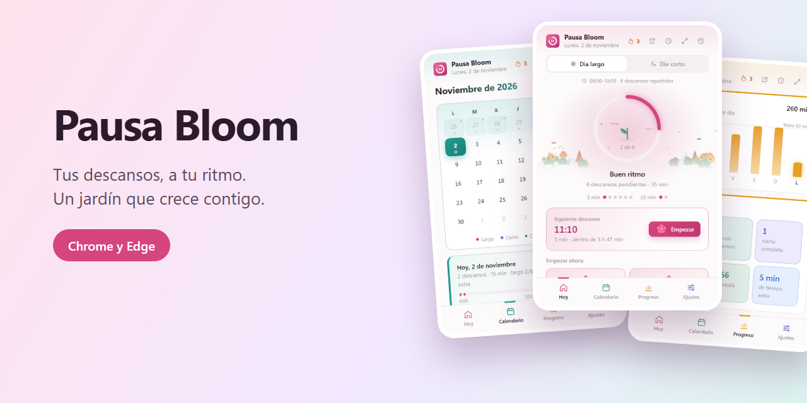
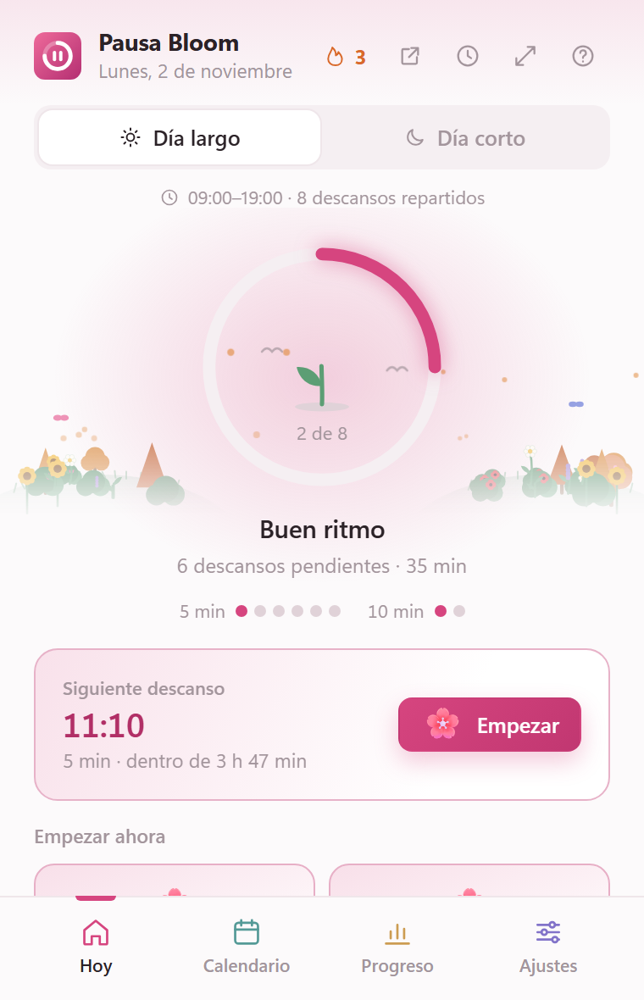
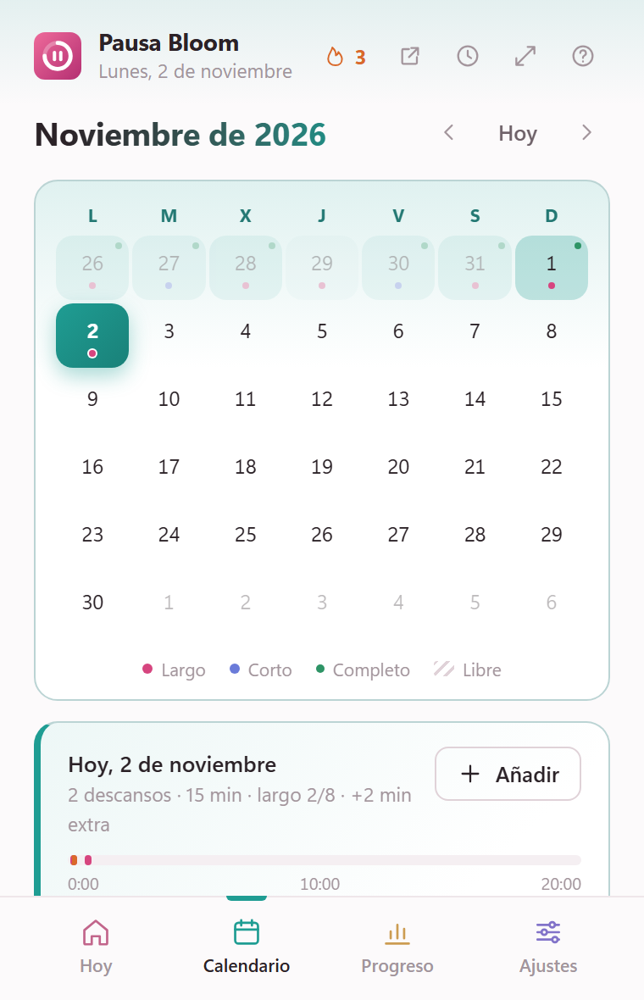
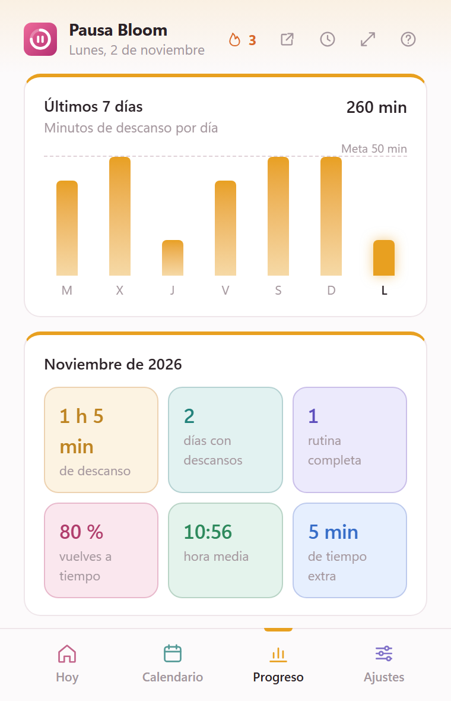
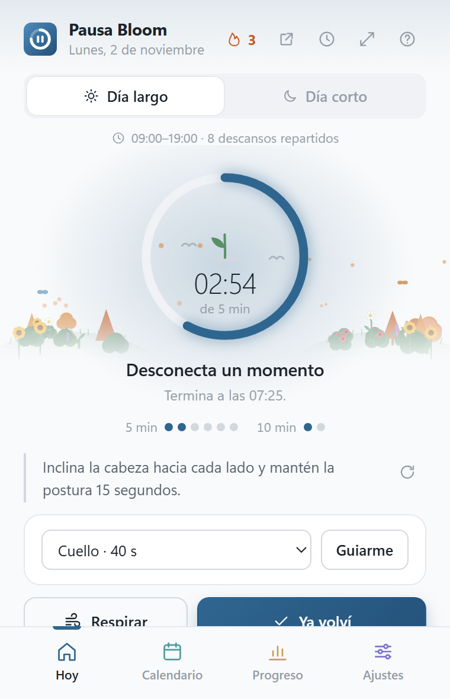
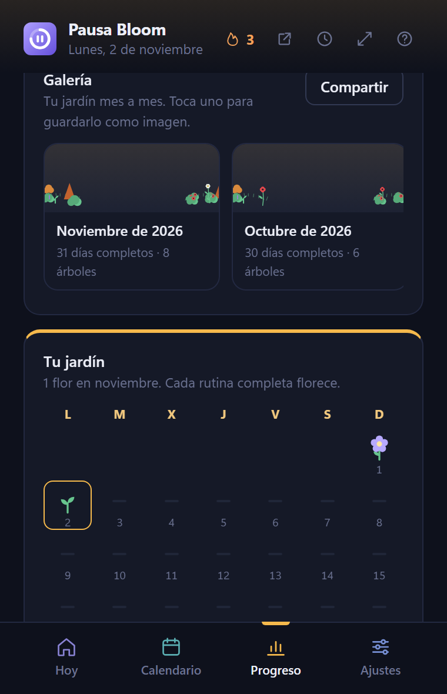
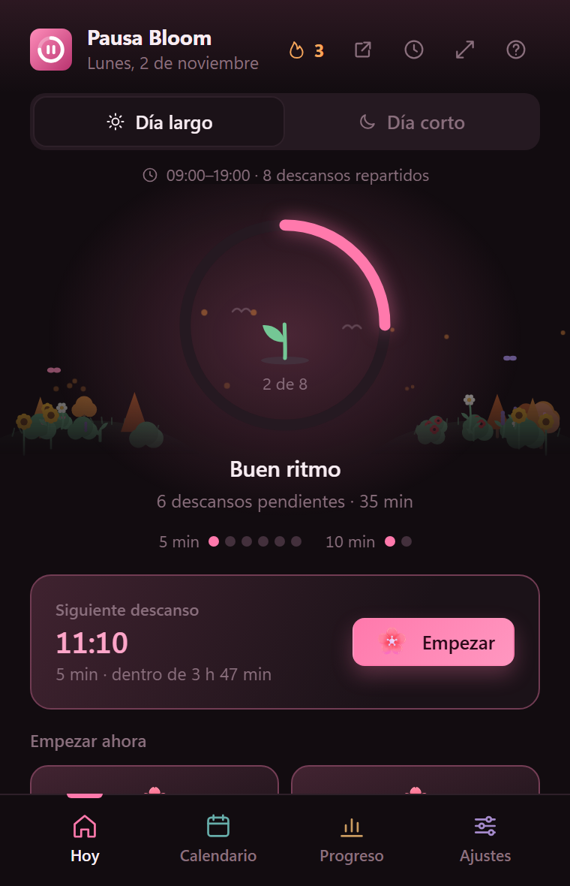
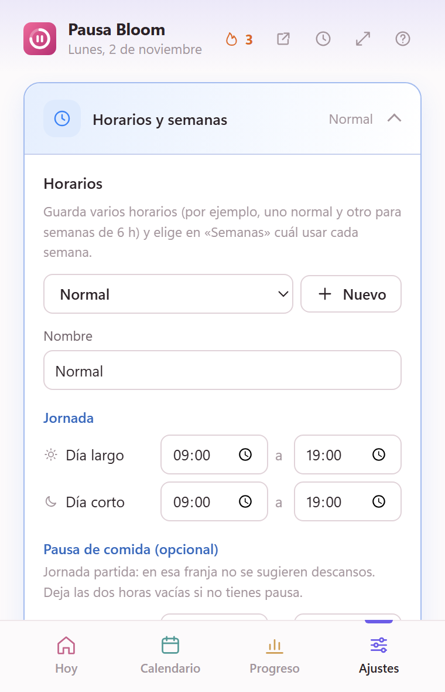

# Pausa Bloom

  

**Tus descansos, a tu ritmo.** Pausa Bloom te ayuda a organizar las pausas de tu jornada, registrar cuándo empiezan, sugerirte la mejor hora para el siguiente y ver cómo progresa tu rutina con un jardín que, con los meses, se convierte en bosque.

> **Descarga:** [Pausa Bloom 3.1 para Chrome y Edge](https://github.com/dannymedinacoronel/Pausa-Bloom/raw/main/PausaBloom-Chrome-Edge.zip)
>
> Descomprime el ZIP y sigue las instrucciones de instalación más abajo.

## Capturas

Capturas reales de la extensión con datos de ejemplo; no incluyen datos personales.

| Hoy | Calendario | Progreso |
|---|---|---|
|  |  |  |

| Descanso en curso | Jardín y retos | Tema oscuro |
|---|---|---|
|  |  |  |

| Ajustes |
|---|
|  |

## Qué incluye

- **Horas sugeridas:** reparte los descansos por la jornada, uno cada X minutos u a horas fijas, y aprende a qué hora sueles descansar.
- **Horarios para semanas muy distintas:** varios horarios guardados, rotación A/B entre semanas, semana libre, jornada partida con pausa de comida, turnos de noche y cambios puntuales de un día.
- **Un toque para empezar:** registra la hora, inicia el temporizador y muestra cuánto queda. Botones «Ya volví», «+5 min» y «Pospón» directamente en las notificaciones.
- **Ejercicios guiados** durante el descanso: cuello, hombros, muñecas, espalda, vista, respiración 4-7-8 y cuadrada, caminata.
- **Jardín que crece:** una planta que florece con cada rutina y un bosque que evoluciona con las estaciones. Retos suaves, días comodín para proteger tu racha, galería mes a mes y una imagen para compartir.
- **Calendario mensual:** consulta, añade, edita y borra descansos; marca días libres.
- **Progreso:** gráfica semanal, resumen del mes, puntualidad, rachas y resumen semanal el domingo.
- **Frases motivadoras** de personas célebres al volver de cada descanso (100, sin repetirse), en español e inglés.
- **Cuatro temas** (Peonía, Porcelana, Medianoche y Rosa Noir), cada sección con su propio color, y un asistente de configuración al empezar.
- **Avisos:** notificaciones, sonidos, atajos de teclado, recordatorio de vista 20-20-20, ventana flotante con la cuenta atrás y movimiento reducido.
- **Copia de seguridad** manual y automática diaria, y exportación a CSV.
- **Privacidad:** los registros se guardan en el almacenamiento local de tu navegador. No se envían a ningún servidor de Pausa Bloom.

### Avisos en el móvil

Puedes vincular un bot de Telegram propio para recibir avisos en tu móvil (se conecta escaneando un código QR). Los mensajes llevan botones para responder sin volver al ordenador. Es opcional: el código del bot queda guardado en este navegador y se utiliza solo para comunicarse con la API de Telegram.

## Instalar en Chrome o Edge

1. Descarga el [ZIP de la última versión](https://github.com/dannymedinacoronel/Pausa-Bloom/raw/main/PausaBloom-Chrome-Edge.zip) y descomprímelo en una carpeta que no vayas a borrar.
2. Abre `chrome://extensions` en Chrome o `edge://extensions` en Edge.
3. Activa **Modo de desarrollador**.
4. Pulsa **Cargar descomprimida** y selecciona la carpeta extraída.
5. Si ya tenías una versión instalada, pulsa **Recargar** para actualizarla.

La extensión utiliza Manifest V3 y no necesita compilarse ni instalar dependencias.

> **Actualizar desde una versión anterior a la 3.1:** esta versión fija el identificador de la extensión, así que Chrome la trata como una instalación nueva. Antes de quitar la antigua, pulsa **Crear copia** en Ajustes → Atajos y datos y, en la nueva, **Restaurar copia**. A partir de ahora los datos se conservan al actualizar.

## Primeros pasos

1. Abre Pausa Bloom desde el botón de extensiones. El asistente te pregunta tu jornada y el tutorial te enseña las funciones.
2. Elige **Día largo** o **Día corto**, o asigna una jornada a cada día de la semana en **Ajustes**.
3. Pulsa la duración de descanso que quieras tomar. Al volver, pulsa **Ya volví**.
4. Personaliza horarios, tema, sonidos y avisos en **Ajustes**.

## Privacidad y permisos

Al instalarla, Chrome muestra los permisos que usa: almacenamiento local y alarmas (funciones básicas), notificaciones del sistema, un documento en segundo plano para reproducir el sonido de fin de descanso, descargas (para la copia automática diaria en tu carpeta Descargas) y acceso a `api.telegram.org` (solo se usa si conectas avisos al móvil). Los datos se almacenan en el perfil local del navegador y no se envían a ningún servidor de Pausa Bloom.

## Licencia y código fuente

Pausa Bloom es un proyecto propietario. El repositorio público contiene información y paquetes descargables, **no el código fuente**. El instalador incluye archivos necesarios para ejecutar una extensión de navegador; publicar un instalador no puede ocultar esos archivos ni hacerlos imposibles de inspeccionar.

El uso y la redistribución están sujetos a la licencia propietaria que acompaña a cada versión. No se concede permiso para reutilizar, modificar o redistribuir el producto. Las restricciones se aplican en la medida permitida por la legislación local; nada aquí pretende eliminar derechos que la ley declare irrenunciables.

## Soporte

¿Encontraste un problema o tienes una sugerencia? [Abre una incidencia](https://github.com/dannymedinacoronel/Pausa-Bloom/issues).
