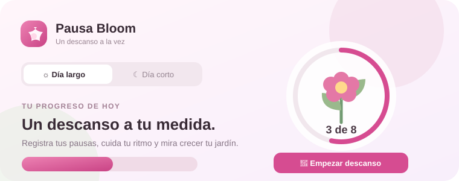
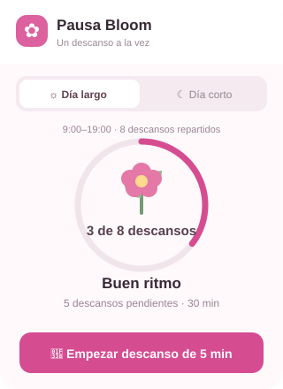
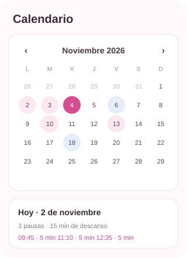
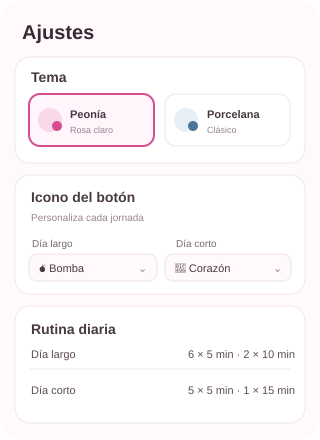

# Pausa Bloom

  

**Tus descansos, a tu ritmo.** Pausa Bloom te ayuda a organizar las pausas de tu jornada, registrar cuándo empiezan y ver cómo progresa tu rutina con un jardín que crece contigo.

> **Descarga:** [Pausa Bloom para Chrome y Edge](https://github.com/dannymedinacoronel/Pausa-Bloom/releases/latest/download/PausaBloom-Chrome-Edge.zip)
>
> Descomprime el ZIP y sigue las instrucciones de instalación más abajo.

## Capturas

Las imágenes de esta página son vistas previas ilustrativas de la interfaz; no incluyen datos personales.

| Hoy | Calendario | Ajustes |
|---|---|---|
|  |  |  |

## Qué incluye

- **Dos jornadas configurables:** de inicio, día largo con 6 descansos de 5 minutos y 2 de 10; día corto con 5 de 5 y 1 de 15.
- **Un toque para empezar:** registra la hora, inicia opcionalmente el temporizador y muestra cuánto queda.
- **Plan del día:** sugerencias para repartir las pausas durante tu horario, con alternativas para intervalos u horas fijas.
- **Calendario mensual:** consulta, añade, edita y borra descansos; marca los días libres.
- **Progreso visual y estadísticas:** anillo y jardín animado, gráficos semanales, resumen mensual y rachas sin presión.
- **Personalización:** cuatro temas y un icono de descanso distinto por jornada, incluida la bomba 💣.
- **Avisos y accesibilidad:** alarmas opcionales, sonidos, atajos de teclado, respiración guiada y movimiento reducido.
- **Copia de seguridad y CSV:** exporta o restaura tu historial cuando quieras.
- **Privacidad:** los registros se guardan en el almacenamiento local de tu navegador. No se envían a ningún servidor de Pausa Bloom.

### Avisos en el móvil

Puedes vincular un bot de Telegram para recibir avisos en tu móvil. Es opcional: el token del bot queda guardado en este navegador y se utiliza para comunicarse con la API de Telegram. Puedes desvincularlo o borrar los datos desde Ajustes.

## Instalar en Chrome o Edge

1. Descarga el [ZIP de la última versión](https://github.com/dannymedinacoronel/Pausa-Bloom/releases/latest/download/PausaBloom-Chrome-Edge.zip) y descomprímelo.
2. Abre `chrome://extensions` en Chrome o `edge://extensions` en Edge.
3. Activa **Modo de desarrollador**.
4. Pulsa **Cargar descomprimida** y selecciona la carpeta extraída.
5. Si ya tenías una versión instalada, pulsa **Recargar** para actualizarla.

La extensión utiliza Manifest V3 y no necesita compilarse ni instalar dependencias.

## Primeros pasos

1. Abre Pausa Bloom desde el botón de extensiones. El tutorial te enseña las funciones principales.
2. Elige **Día largo** o **Día corto**, o asigna automáticamente una jornada a cada día de la semana en **Ajustes**.
3. Pulsa la duración de descanso que quieras tomar. Al volver, pulsa **Ya volví**.
4. Personaliza el tema, los iconos y las pausas en **Ajustes**.

En las opciones predeterminadas se registran **50 min de descanso** para el día largo y **40 min** para el corto.

## Privacidad y permisos

La extensión solicita almacenamiento local y alarmas para sus funciones básicas. Las notificaciones del sistema son opcionales. La conexión con Telegram y su permiso de red son opcionales y solo se usan si configuras avisos en el móvil. Los datos se almacenan en el perfil local del navegador.

## Licencia y código fuente

Pausa Bloom es un proyecto propietario. El repositorio público contiene información y paquetes descargables, **no el código fuente**. El instalador incluye archivos necesarios para ejecutar una extensión de navegador; publicar un instalador no puede ocultar esos archivos ni hacerlos imposibles de inspeccionar.

El uso y la redistribución están sujetos a la licencia propietaria que acompaña a cada versión. No se concede permiso para reutilizar, modificar o redistribuir el producto. Las restricciones se aplican en la medida permitida por la legislación local; nada aquí pretende eliminar derechos que la ley declare irrenunciables.

## Soporte

¿Encontraste un problema o tienes una sugerencia? [Abre una incidencia](https://github.com/dannymedinacoronel/Pausa-Bloom/issues).
